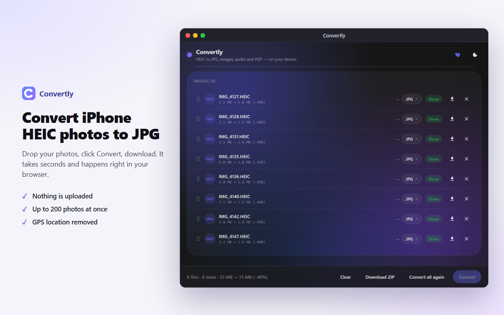

# Convertly — HEIC to JPG Converter

A Chrome / Edge (Manifest V3) extension that converts iPhone **HEIC photos to JPG** right in the browser, plus other images, audio and PDF/Word documents. Everything happens on your device: no uploads, no servers, no account, no analytics. Converted photos carry no GPS or other EXIF metadata.



## How it works

1. Click the Convertly icon. A converter window opens (a real window, so it stays open while you pick files).
2. Drop your HEIC photos into it, or click to choose them.
3. Click **Convert**, then download the files one by one or all at once as a ZIP.

Up to 200 files per batch, several converted in parallel. The output format can be set for all files or per file.

## What it converts

| Type | In | Out |
|---|---|---|
| **Images** | HEIC, HEIF, JPG, PNG, WebP, GIF, BMP, AVIF, TIFF, SVG | JPG, PNG, WebP, AVIF, TIFF, BMP, PDF (all images in one) |
| **Audio** | MP3, WAV, FLAC, M4A, AAC, OGG | MP3, WAV, OGG (Vorbis) |
| **PDF** | PDF | merge, split, rotate, compress, keep/reorder pages, watermark and page numbers; to JPG, PNG, text, DOCX (text, beta) |
| **Word** | DOCX | PDF (beta: visual or text), text, HTML |

Images: quality (90% by default) and resize (percent or longest side). Audio: trim, mono, normalize, MP3 bitrate.

## Privacy and permissions

The only permission is `storage`, for settings. There are no host permissions and no content scripts: Convertly cannot read the websites you visit, and its window cannot be opened or detected by them. Files are read and converted in the extension's own window and are never sent anywhere; the extension makes no network requests. All code, including the HEIC decoder and the audio/AVIF encoders, ships in the package (CSP `script-src 'self' 'wasm-unsafe-eval'`).

## Languages

The interface and the store listing are in 14 languages: English, German, Spanish, French, Italian, Dutch, Polish, Portuguese (Brazil), Turkish, Ukrainian, Russian, Japanese, Korean and Simplified Chinese. The window follows the browser language. Strings live in `src/i18n/<locale>.json` (`en.json` is the source of keys; plural forms are `key.one`, `key.few`, `key.many`, `key.other`); `node scripts/locales.mjs` writes the extension name and description to `public/_locales/` (it also runs before every build). Store descriptions are in `store/descriptions/`.

## Develop

Requirements: Node.js 20+.

```bash
npm ci
npx playwright install chromium
npm run build      # typecheck + production build → dist/
npm test           # unit tests (Vitest)
npm run test:e2e   # end-to-end tests: the built extension in Chromium (Playwright)
npm run zip        # dist/ → release/convertly-<version>.zip
npm run check      # npm audit + build + all tests + zip
npm run store      # store screenshots, tiles and demo video, captured from the real UI
```

Load unpacked: `chrome://extensions` → Developer mode → Load unpacked → `dist/`. Chrome or Edge 116+.

`npm run store` needs Windows with the HEIF and HEVC extensions (to encode the demo HEIC photos, see `scripts/lib/heic-encode.ps1`) and Google Chrome installed (its H.264 encoder writes the video).

## Website

The same converter also runs in a plain web page: a static site for GitHub Pages with one landing page per task (`/heic-to-jpg/`, also the site root, `/heic-to-png/`, `/heic-to-pdf/`, `/webp-to-jpg/`, `/merge-pdf/`, `/wav-to-mp3/`), each opening the converter preset for that task and linking to the Chrome Web Store listing.

```bash
npm run build:web     # typecheck + site build → site-dist/
npm run test:web      # Playwright tests of the built site (vite preview, headless Chromium)
npm run dev:web       # dev server
npm run preview:web   # serve site-dist/ as GitHub Pages would
```

- Pages are generated from `site/pages.ts` (slug → converter preset) and `site/content/<lang>.ts` (titles, text, FAQ) by `site/render.ts`; `vite.web.config.ts` feeds them to Vite as virtual HTML entries and writes `sitemap.xml`, `robots.txt` and `og.png`. English is the default language at the site root; another language is one more file in `site/content/`, served under `/<lang>/`.
- Settings are kept in `localStorage` (the extension uses `chrome.storage.local`). The converter follows the page's language.
- Same promise as the extension: every file comes from the site itself, nothing is uploaded, no analytics, no cookies. A strict CSP meta tag (`default-src 'none'`, scripts and workers from the site only) is part of every page, and the tests fail on any CSP violation or request to another origin.
- GitHub Pages can't send COOP/COEP headers, so the page isn't cross-origin-isolated and the AVIF encoder uses its single-threaded build (tested).
- `site/config.ts` holds the site URL and the extension's Chrome Web Store id; while it is empty, local builds warn, CI builds fail and the deploy workflow (`.github/workflows/pages.yml`, Settings → Pages → Source: GitHub Actions) stops before building.

## Layout

```
src/
  background.ts        toolbar click → opens or focuses the converter window
  manifest.config.ts   MV3 manifest (storage only)
  ui/                  window UI: dropzone, options, file list, results (vanilla TS)
  app/                 controller (state, per-file targets), job queue (bounded pool)
  core/                tool registry; one Tool per conversion in core/tools/
  infra/               decoders/encoders, PDF/DOCX rendering, downloads, settings
  i18n/                UI strings in 14 languages
site/                  website: landing pages, their text, the page entry and styles
tests/                 unit tests; tests/e2e: Playwright tests of the built extension; tests/web: of the website
scripts/               build helpers, icons, locales, store assets
store/                 store listing texts, privacy policy, screenshots, tiles, video
```

## Dependencies (all bundled, no CDN)

| Package | Use | Licence |
|---|---|---|
| `heic-to` (`/csp` build) | HEIC/HEIF decode (libheif/libde265) | LGPL-3.0 |
| `@jsquash/avif` | AVIF encode (WASM) | Apache-2.0 |
| `utif2` | TIFF decode + encode | MIT |
| `upng-js` (+ `pako`) | PNG encode (below 90% quality: palette quantisation) | MIT |
| `@breezystack/lamejs` | MP3 encode | LGPL-3.0 |
| `wasm-media-encoders` | Ogg Vorbis encode (WASM) | MIT |
| `fflate` | ZIP download + DOCX writing | MIT |
| `pdf-lib` | PDF create / rotate / split / merge / stamp, images → PDF | MIT |
| `pdfjs-dist` | PDF → image render + text extraction | Apache-2.0 |
| `mammoth` | DOCX → HTML / text | BSD-2-Clause |
| `html2canvas` | DOCX → PDF visual rendering | MIT |
| `@pdf-lib/fontkit` + `@expo-google-fonts/roboto` | Unicode font for reflowed PDF text | MIT / OFL-1.1 |

The LGPL-3.0 libraries (`heic-to`/libheif/libde265, `lamejs`) are shipped unmodified.

## Limitations

- Animated GIF and multi-page TIFF: the first frame/page only.
- DOCX → PDF and PDF → DOCX are best-effort (beta); PDF → DOCX keeps text only.
- PDF compression turns pages into images: great for scans, text PDFs may get bigger.
- Very long audio is decoded in memory as a whole.
- Video is not supported (it would need a server or a ~30 MB encoder).

## Privacy

Convertly converts the files you choose on your device and never transmits, sells or shares them; it makes no network requests. Only its settings are stored, locally. Full policy: [store/PRIVACY.md](store/PRIVACY.md).

Convertly's use of the data it handles adheres to the [Chrome Web Store User Data Policy](https://developer.chrome.com/docs/webstore/program-policies/), including the Limited Use requirements.

Support development: [Ko-fi](https://ko-fi.com/antalikra) · [PayPal](https://www.paypal.com/donate/?hosted_button_id=AXQ9EVTZL6TDA)
